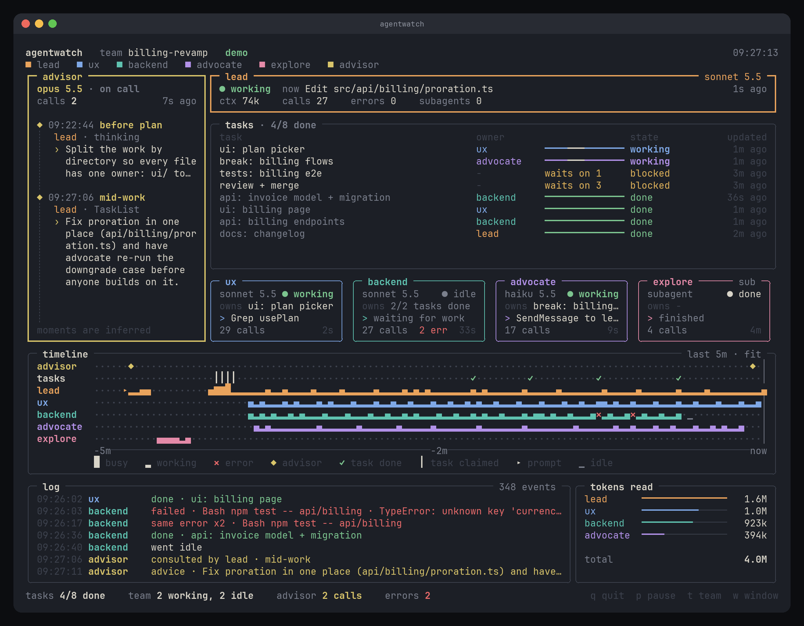
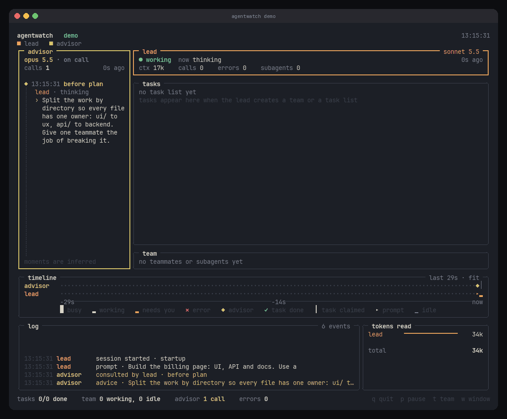

# agentwatch

[](https://github.com/kodepapa/agent-watch/actions/workflows/ci.yml)
[](LICENSE)


**A live terminal dashboard for Claude Code sessions and agent teams.**

See what your agents are doing while they do it: the lead, every teammate and
subagent, the shared task list, advisor calls, a per-agent timeline, a log tail
and token usage. Everything on screen comes from data Claude Code already
exposes (hooks, team and task files, session transcripts). Nothing is staged.



<details>
<summary>Watch it move (demo session, sped up)</summary>



</details>

## What you get

- **Lead and team cards**: who is working, idle or done, what each agent is
  running right now, call and error counts, context size and model.
- **Task list**: the team's shared tasks with owner, state and what each
  blocked task is waiting on.
- **Advisor panel**: every advisor call, who asked, and the advice that came back.
- **Timeline**: one row per agent showing activity, errors, task claims and
  completions over the last minutes or hours.
- **Log and tokens**: a readable event tail (including repeated errors) and
  tokens read per agent.
- **Record and replay**: save a session to a file and play it back later at any speed.
- **Screenshots**: render any frame to PNG or SVG without a terminal.

## Quick start

Requires Python 3.10 or newer. Try the simulated session first; it needs no
Claude Code setup.

```sh
pipx install "git+https://github.com/kodepapa/agent-watch"
agentwatch demo
```

Or with Homebrew (macOS and Linux):

```sh
brew tap kodepapa/agent-watch https://github.com/kodepapa/agent-watch
brew install kodepapa/agent-watch/agentwatch
```

`pip install` works too. For PNG export, install the `screenshots` extra (not
included in the Homebrew build):
`pipx install "agentwatch[screenshots] @ git+https://github.com/kodepapa/agent-watch"`.

## Watch your own sessions

```sh
agentwatch install-hooks         # adds async hooks to ~/.claude/settings.json (backs it up first)
claude                           # in another terminal, as usual
agentwatch                       # live monitor
```

`install-hooks --dry-run` prints the JSON instead of writing it, and
`--settings .claude/settings.local.json` installs for one project only.
`agentwatch uninstall-hooks` removes exactly what it added.

### What the hook does

The hook script ([`agentwatch/hooks/emit.py`](agentwatch/hooks/emit.py), 85
lines) appends one JSON line per event to `~/.agentwatch/events.jsonl` and
exits. It runs as an async hook, uses only the standard library, trims long
fields to 400 characters, and never returns an error to Claude Code.
Everything stays on your machine: agentwatch makes no network calls.

### Terminal fonts

Boxes, bars and the timeline use Unicode box-drawing and block characters,
which every modern terminal font covers. If yours shows gaps or question marks,
pass `--ascii` (or set `AGENTWATCH_ASCII=1`) for plain ASCII.

## Keys

`q` quit, `p` pause, `t` switch team, `w` timeline window (fit, 2m, 10m, 30m, 2h),
`+` / `-` replay speed.

## Commands

| command | what it does |
|---|---|
| `agentwatch` | live monitor (`--team`, `--since 30m`, `--record file.jsonl`, `--advisor-model "opus 5.5"`) |
| `agentwatch demo` | simulated session (`--speed 4`, `--at 0.6` to freeze at 60%) |
| `agentwatch replay file.jsonl` | play back a recording (`--speed`, `--at`) |
| `agentwatch doctor` | show raw hook keys, resolved agents, teams, tasks and advisor calls |
| `... --screenshot out.png` | render one frame to PNG or SVG and exit (`--size 132x46`) |

## Where each panel's data comes from

| panel | source |
|---|---|
| lead, team cards, log, timeline | hook events: tool calls, failures, subagents, idle, stop, tasks |
| task list | `~/.claude/tasks/<team>/*.json`, one file per task |
| team members and models | `~/.claude/teams/<team>/config.json` |
| advisor calls and advice | `server_tool_use` blocks named `advisor` in the session transcript |
| tokens read, context size, model | `usage` and `model` on assistant messages in the transcript |

Advisor "moments" (before plan, after error, mid-work, before done) are
inferred from what the agent was doing when it called the advisor. Claude Code
does not report a reason, so the panel labels them as inferred.

## What is verified and what is assumed

Verified against Claude Code's docs: the hook event names, async hooks, the
`PostToolUseFailure` `error` field, `SubagentStart`/`SubagentStop` `agent_id`
and `agent_type`, and the team and task folder locations.

Assumed, and isolated in `agentwatch/normalize.py` so they are easy to fix:

- **Teammate names in hook payloads.** agentwatch looks for `teammate_name` or
  `agent_name`, then for `CLAUDE_*AGENT*`/`*TEAMMATE*` environment variables,
  then team-config session ids. Sessions it can't name show as `session-xxxxxx`.
- **Task file fields** (`subject`, `status`, `owner`, `blockedBy`). Agent team
  files are not a documented schema and may change between releases.
- **Advisor transcript blocks.** Detected by name, and advice text is shown only
  when the result block carries text.

After your first real session, run `agentwatch doctor`. It prints the keys each
hook event actually sent and how every session was resolved, which tells you
whether any of the above needs adjusting.

## Layout

```
agentwatch/
  hooks/emit.py   hook script Claude Code runs
  normalize.py    raw payloads, team/task files, transcripts -> Events
  sources.py      live collector (tails files) and replay collector
  model.py        Event and the State reducer
  panels.py       one widget per panel, each draws its own box
  app.py          Textual layout, refresh loop, keys
  sim.py          demo session writer
  shot.py         SVG/PNG screenshots
```

## Status

agentwatch is alpha (0.1.0). It is developed and tested against a simulated
session; the three assumptions listed above have not yet been confirmed against
a real agent-team run. If a panel looks wrong on your sessions, the output of
`agentwatch doctor` in an issue is the most useful thing you can send.

Tested on Linux. macOS should work; Windows is untested.

## Development

```sh
git clone https://github.com/kodepapa/agent-watch && cd agent-watch
pip install -e ".[dev]"
python -m pytest                 # 11 tests, about 10s
ruff check .
agentwatch demo --at 0.58 --screenshot docs/screenshot.png   # regenerate the screenshot
python scripts/make_gif.py docs/demo.gif                     # regenerate the GIF
```

Issues and pull requests are welcome. Two rules keep the project honest: every
guess about Claude Code's field names lives in `normalize.py`, and no panel
shows data that Claude Code doesn't actually provide.

## License

MIT, see [LICENSE](LICENSE). The bundled JetBrains Mono font (used only for PNG
screenshots) is under the SIL Open Font License, see
[`agentwatch/fonts/OFL.txt`](agentwatch/fonts/OFL.txt).

agentwatch is an independent project and is not affiliated with or endorsed by
Anthropic. Claude and Claude Code are trademarks of Anthropic.
